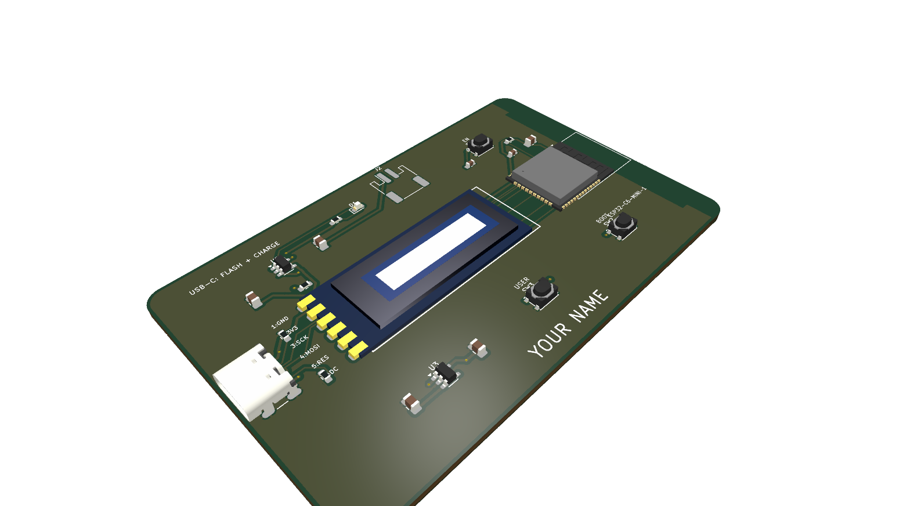
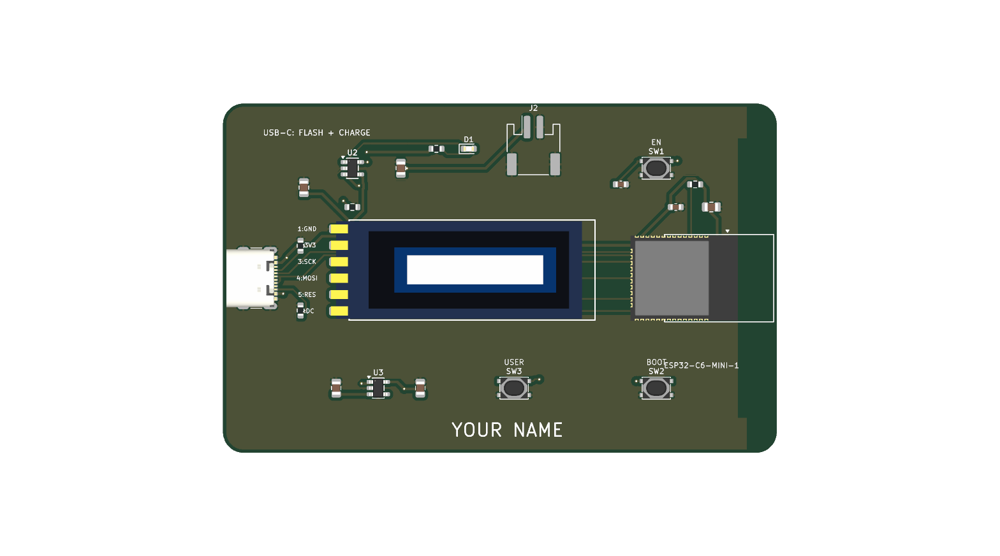
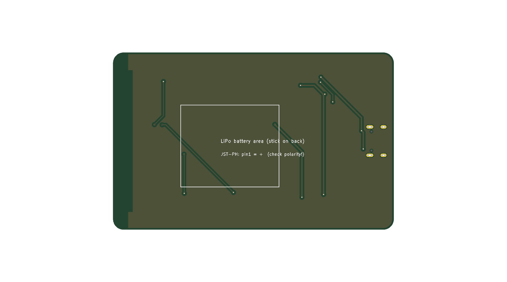

# ESP32-C6 Smart PCB Business Card

An ultra-slim, monolithic smart electronic business card in the standard ISO/IEC 7810 ID-1 credit card form factor ($85.6 \times 54.0\text{ mm}$), powered by an **Espressif ESP32-C6-MINI-1** with an integrated **0.91" 128×32 SPI OLED display**, onboard USB-C programming and autonomous Li-Po battery charging.

Everything is designed for direct surface-mount soldering with **zero pin headers, zero sockets, and zero through-holes** for the OLED.

---

## 📸 Photorealistic 3D Renders

| Isometric / Perspective View | Top View | Bottom View |
| :---: | :---: | :---: |
|  |  |  |

---

## ⚡ Key Specifications

- **Dimensions:** $85.6\text{ mm} \times 54.0\text{ mm} \times 1.6\text{ mm}$ (Standard ID-1 Credit Card Size, $3.18\text{ mm}$ corner radius)
- **Microcontroller:** **ESP32-C6-MINI-1-N4**
  - High-performance 32-bit RISC-V processor (up to 160 MHz) + Low-power RISC-V coprocessor
  - 2.4 GHz Wi-Fi 6 (802.11ax), Bluetooth 5 (LE), Zigbee 3.0 & Thread (802.15.4 / Matter)
  - Onboard PCB trace antenna with dedicated RF clearance keepout
- **Display:** **0.91" 128×32 SPI OLED Display** (SSD1306 driver)
  - Direct SMD soldered via 6 castellated ENIG edge pads ($2.54\text{ mm}$ pitch)
  - **Zero through-holes / zero pin headers** — sits completely flush on the front copper
- **USB-C Interface:** GCT USB4105 16-pin USB Type-C receptacle
  - Native USB-Serial/JTAG for flashing firmware and serial debugging
  - $5.1\text{ k}\Omega$ CC pull-down resistors for USB-C PD compatibility
  - Powers and recharges the card from any standard USB-C port
- **Battery & Power System:**
  - Autonomous Li-Po charger: Microchip **MCP73831T-2ACI/OT** (configured for $\sim 300\text{ mA}$ charge rate)
  - Red SMD charge indicator LED (`CHG`)
  - Low-dropout regulator: Diodes Inc **AP2112K-3.3** ($600\text{ mA}$ output, $55\,\mu\text{A}$ quiescent current)
  - Battery connector: SMD horizontal JST-PH 2-pin connector (`J2`) + dedicated rear $30 \times 25\text{ mm}$ mounting area for adhesive-backed $3.7\text{V}$ Li-Po pouch cells (`302030` / `402030`, $150\text{–}250\text{ mAh}$)
- **Interactive Controls:**
  - `EN` (Reset) tactile switch (`SW1`) with RC debounce filter
  - `BOOT` (GPIO9) tactile switch (`SW2`) for firmware downloads / user input
  - `USER` (GPIO4) tactile switch (`SW3`) for custom menu / interaction

---

## 📌 ESP32-C6 Pinout & Signal Mapping

| Signal | ESP32-C6 Pin | GPIO / Function | Description |
| :--- | :---: | :---: | :--- |
| **OLED SCL / SCK** | Pin 19 | GPIO14 | SPI Clock |
| **OLED SDA / MOSI**| Pin 20 | GPIO15 | SPI Master Out Slave In |
| **OLED RES** | Pin 22 | GPIO8 | Display Hardware Reset |
| **OLED DC** | Pin 24 | GPIO18 | Data / Command Selection |
| **USER Button** | Pin 9 | GPIO4 | Active-Low User Input Button |
| **BOOT Button** | Pin 23 | GPIO9 | Boot Mode / User Button 2 |
| **RESET Button** | Pin 8 | CHIP_EN | Chip Enable / Reset |
| **USB D-** | Pin 17 | GPIO12 | Native USB Serial/JTAG D- |
| **USB D+** | Pin 18 | GPIO13 | Native USB Serial/JTAG D+ |
| **STAT** | — | — | MCP73831 Charger Status to LED `D1` |

---

## 📦 Manufacturing & Ordering Files

The card is 100% routed and DRC verified in KiCad:
- **Gerbers & Drill Package:** [`aio_card_gerbers.zip`](aio_card_gerbers.zip) — Ready for one-click upload to JLCPCB / PCBWay / Oshpark.
- **Full KiCad PCB:** [`aio_card.kicad_pcb`](aio_card.kicad_pcb)
- **Bill of Materials (BOM):** [`fab_aio/BOM.csv`](fab_aio/BOM.csv)
- **Pick-and-Place Centroids (CPL):** [`fab_aio/CPL.csv`](fab_aio/CPL.csv)
- **Design Automation Script:** [`c6_card.py`](c6_card.py)
